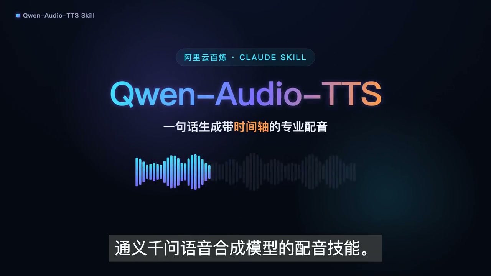

# lizhe-skills

个人维护的 Codex Skills 仓库，主要收录中文语音合成与音频生成工作流。每个一级目录都是一个可独立安装的 Skill；入口均为该目录下的 `SKILL.md`。

## 演示

[](./assets/ali-qwen-audio-tts-intro.mp4)

> 42 秒介绍视频：Qwen-Audio-TTS 配音、字级时间戳驱动的字幕动画与程序化音效。点击封面播放或下载 MP4。

## Skills

| Skill | 用途 |
| --- | --- |
| [`ali-qwen-audio-tts`](./ali-qwen-audio-tts/) | 通过阿里云百炼的 Qwen-Audio-TTS 或 Sambert 合成配音、旁白与时间戳。 |
| [`doubao-tts-skill`](./doubao-tts-skill/) | 通过火山引擎豆包 TTS 合成多语种音频、字幕和字级时间戳。 |
| [`doubao-audio-generation`](./doubao-audio-generation/) | 通过火山引擎 Seed Audio 生成音效、配音和参考素材驱动的定制音频。 |

## 仓库约定

- 每个 Skill 以 `SKILL.md` 为入口；脚本放在 `scripts/`，按需查阅的资料放在 `reference/` 或 `references/`。
- 凭证只从环境变量读取，绝不提交 API Key、`.env` 或私钥。
- `node_modules/`、构建输出、Python 缓存、独立维护的视频工程与可再生成的维护采样均被忽略；可发布的宣传视频统一放在 `assets/`。
- 小型示例音频可随 Skill 提交；大规模维护采样默认本地保存。如确实需要版本化大文件，请使用 Git LFS，而非直接加入普通 Git 历史。

## 发布到 GitHub

首次发布前，请在 GitHub 创建一个空仓库，然后执行：

```bash
git add .
git status
git commit -m "chore: publish skills repository"
git branch -M main
git remote add origin <你的 GitHub 仓库地址>
git push -u origin main
```

推送前请确认 `git status` 中没有 `.env`、密钥或不必要的大型二进制文件；建议同时在 GitHub 仓库设置中开启 Secret Scanning 与 Push Protection。

## License

本仓库采用 [MIT License](./LICENSE)。第三方服务、模型、SDK 和文档仍受其各自的条款约束。
